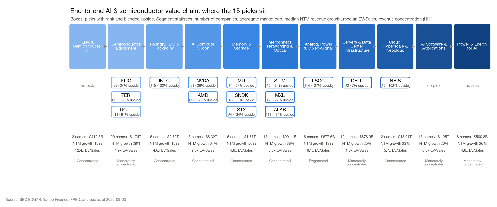
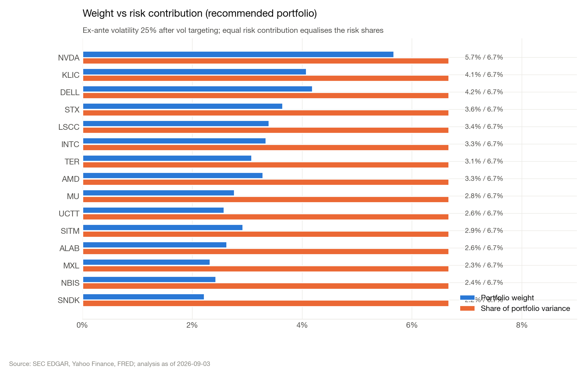
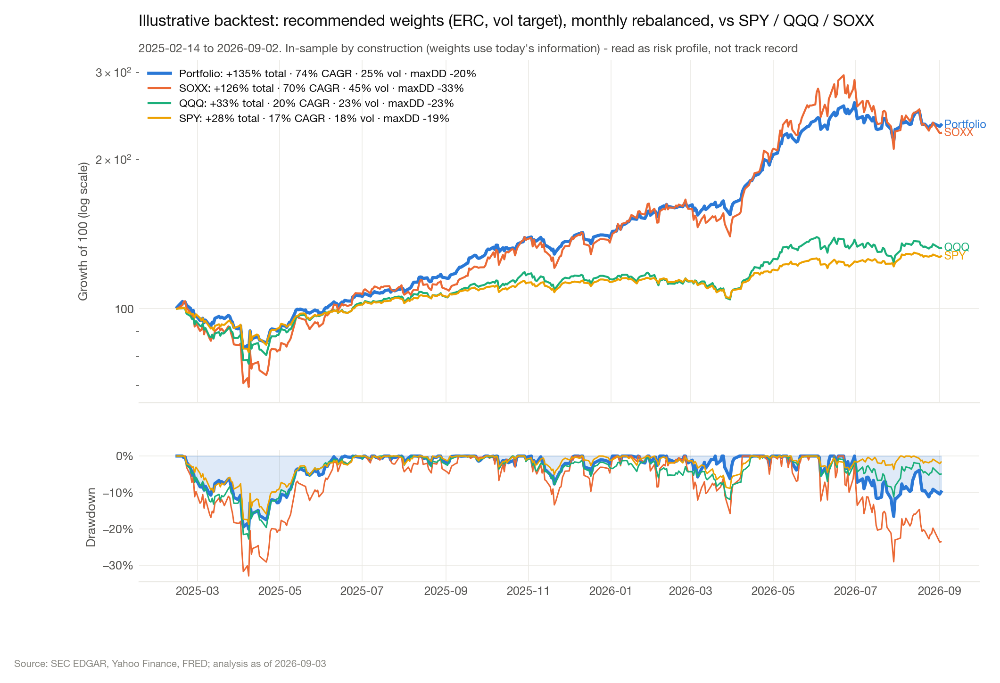
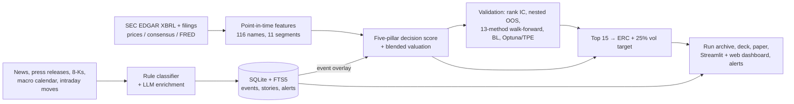

# MarketIntel
Can an always-on, auditable information pipeline plus disciplined portfolio construction turn the AI-semiconductor supply chain into an investable, explainable signal?

 

## Research question
The AI build-out runs through a long physical supply chain: design tools, wafer equipment, foundry and packaging, accelerators, memory, interconnect, power silicon, servers, cloud capacity and power generation. Prices along this chain move on a stream of filings, guidance changes and news, while valuations in the chain disagree sharply about how much growth is already priced. This project asks whether that stream can be captured continuously and reproducibly, from SEC filings, news and macro data, and turned into a ranked, risk-budgeted portfolio whose every number can be traced back to its evidence. It also asks which parts of the signal survive a point-in-time test.

## Key findings
- **The textbook value tilt fails inside this chain, and growth acceleration carries the signal.** In a point-in-time reconstruction (105 US filers, 176 month-ends, 2012–2026, every XBRL fact used only after its filing date), the original value-heavy composite had a 12-month rank IC of −0.083 (Newey–West t = −3.1). Of 36 pre-registered features, growth acceleration was the only one that passed the strict rule (3-month IC +0.033, t = 2.33). The rebuilt score (fundamental momentum, price momentum and a small growth-adjusted valuation term) has a 3-month IC of +0.026 (permutation p = 0.013) and 8.3% annual alpha against SPY and SOXX (t = 2.1).
- **Risk budgeting and a volatility target matter more than the choice of optimiser.** Fully invested constructions on the same top 15 all land at Sharpe 1.08–1.13. Adding a 25% ex-ante volatility target with the remainder in cash lifts Sharpe to 1.17–1.22 and cuts the maximum drawdown from about 30% to 20–23%. Equal risk contribution with the vol target (Sharpe 1.22, drawdown −21%) became the production construction.
- **No construction method beats 1/N with statistical confidence.** In a 164-month point-in-time walk-forward of 13 methods, max diversification leads (Sharpe 1.09) and risk parity ranks 8th, but no method clears |t| ≥ 2 against equal weight. Black–Litterman views add 5.3% a year of return but 4.9 points of volatility, so the Sharpe gain is just 0.013 (t = 1.58).
- **Hyper-parameter search overfits when it is tested honestly.** Optuna/TPE (6 studies × 80 trials over 1,008 configurations) beat fixed ERC in development (Sharpe 0.908 vs 0.867). On the frozen 2024–2026 terminal window it lost (1.352 vs 1.879) because it bought its higher return with much more risk. Fixed ERC stays the control.
- **The monitor runs at production scale.** Between 2 and 25 September 2026 the event store took in 36,384 items: 34,517 news stories, 1,595 press releases, 118 SEC filings, plus price, macro and policy events. It clustered them into 26,700 stories, enriched 3,915 with an LLM, and recorded the classifier version, model, prompt version and input/output hashes for each event.

<p align="center"></p>
<p align="center"> </p>
<sub>Top: where the selected names sit in the chain (2026-09-03 run). Left: ERC equalises each name's share of portfolio variance at a 25% ex-ante vol target. Right: an illustrative in-sample risk profile of the recommended weights against SPY/QQQ/SOXX. It shows drawdown behaviour and is not a track record. The out-of-sample evidence is in the findings above.</sub>

## Approach
The repository has two halves that share one universe of about 116 US-listed names in 11 value-chain segments.

**`ai_semi_intel`** is the research pipeline. It pulls SEC XBRL company facts, prices and consensus, and FRED macro data, then scores every name on a five-pillar decision score: growth 37.5%, momentum 26.25%, value 11.25%, strategic scarcity 15% and risk resilience 10%. Each name is valued with a blended DCF, a cross-sectional multiple regression and consensus targets. The top 15 go into a volatility-targeted equal-risk-contribution portfolio. The scarcity pillar is an evidence-logged LLM research rubric that is versioned, cited and refreshed only on new evidence. Separate research arms test the score point in time, compare 13 construction methods, run Black–Litterman and run a nested Optuna/TPE search. Every run is archived with a `run_id` and input hashes.

**`market_intel`** is the always-on event monitor. Pollers for SEC EDGAR (current filings with 8-K item codes, plus full-text search), RSS and Google/Yahoo news, press releases, FRED and intraday prices feed a deterministic rule classifier. An optional LLM enrichment layer (Anthropic or OpenAI, structured JSON, budgeted and logged) runs on top. Events are de-duplicated into a SQLite store with FTS5 search, grouped into stories, scored per ticker with value-chain read-through, and turned into alerts, a pre-market brief, a Q&A endpoint and an event overlay that feeds back into the daily score.



## Repository layout
| Path | Contents |
|---|---|
| `ai_semi_intel/config/` | All assumptions (`settings.py`) and the value-chain universe map (`universe.py`) |
| `ai_semi_intel/data/` | EDGAR, Yahoo Finance, FRED loaders; optional PitchBook hook |
| `ai_semi_intel/analysis/` | Fundamentals, valuation (DCF / regression / consensus), scoring, strategic rubric, risk |
| `ai_semi_intel/portfolio/` | ERC optimiser, 13 construction methods, Black–Litterman, walk-forward evaluation |
| `ai_semi_intel/research/` | Point-in-time panel, factor lab, IC tests, portfolio sweep, Optuna/TPE, live IC |
| `ai_semi_intel/{charts,deck,dashboard}/` | Charts, PowerPoint deck, static and Streamlit dashboards |
| `market_intel/sources/` | SEC, RSS, Google/Yahoo news, macro and price pollers |
| `market_intel/classify/` | Rule classifier and LLM enrichment with lineage |
| `market_intel/` (core) | Store, stories, scoring, alerts, brief, Q&A, FastAPI server, auth and audit log |
| `market_intel/platform/` | Versioned research-run registry, PIT datasets, paper/shadow ledger, risk adapter |
| `market_intel/static/` | Web dashboard (English / 中文 / 日本語) |
| `scripts/` | Data fetch, validation, constructions, BL, Optuna, daily scheduler and launchd templates |
| `desktop_app/` | Small macOS WebKit shell for the local dashboard |
| `tests/` | 1,200+ unit, contract and frontend tests on synthetic fixtures |
| `docs/` | Methodology, factor research, constructions, Black–Litterman, Optuna/TPE, monitor design, ADR |
| `paper/` | Research paper (PDF) |

## Reproducing
```bash
pip install -r requirements.txt
cp .env.example .env              # set FRED_API_KEY and SEC_USER_AGENT; LLM keys are optional
python -m ai_semi_intel.pipeline  # data -> scores -> portfolio -> charts -> deck -> dashboard (writes outputs/)
python scripts/fetch_long_history.py && python scripts/run_validation.py   # point-in-time backtest + IC suite
python -m market_intel serve      # event monitor + dashboard on http://127.0.0.1:8787
python -m pytest -q               # tests run on synthetic fixtures, no data needed
```
Data come from public sources: SEC EDGAR, Yahoo Finance, FRED and public RSS feeds. They are fetched at run time into `data_cache/` and are not redistributed here. The PitchBook adapter is optional and needs your own licence. Without an LLM key, classification runs rules-only. More detail: [`docs/METHODOLOGY.md`](docs/METHODOLOGY.md), [`docs/FACTOR_RESEARCH.md`](docs/FACTOR_RESEARCH.md), [`docs/CONSTRUCTIONS.md`](docs/CONSTRUCTIONS.md), [`docs/BLACK_LITTERMAN.md`](docs/BLACK_LITTERMAN.md), [`docs/OPTUNA_TPE.md`](docs/OPTUNA_TPE.md), [`docs/MARKET_INTEL.md`](docs/MARKET_INTEL.md).

## Paper / report
[*AI Semiconductor Value Chain: Fundamental Screening, Blended Valuation, and a Black–Litterman Portfolio Across the End-to-End Stack*](paper/AI_Semiconductor_Value_Chain_Research_Paper.pdf) (working paper, September 2026, 24 pp.). It covers the universe map, valuation framework and portfolio, with addenda on the point-in-time validation that rebuilt the score and on the strategic-role (scarcity and risk) pillar.

Research software for discussion purposes only; not investment advice.

## Author
Siyan Chen · University of California, Santa Barbara · siyan_chen@ucsb.edu
